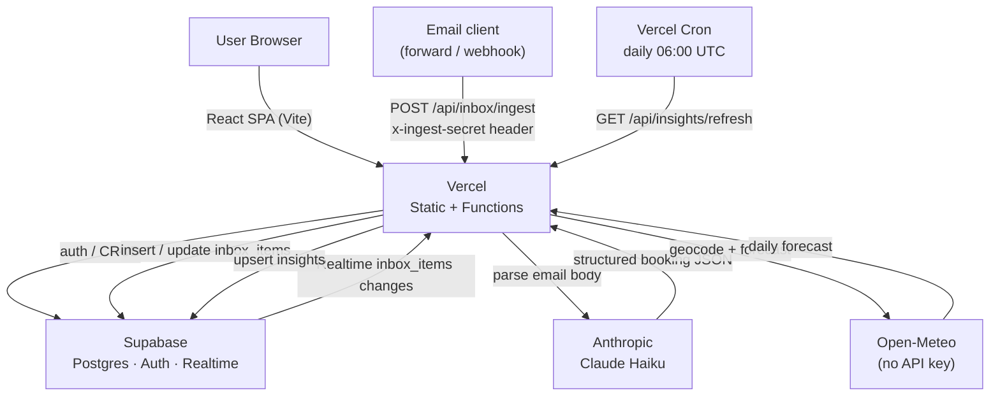

# Travel OS

A personal trip-management app — pipeline, inbox, calendar, budget, packing, and documents all in one place.

## Features

- **Pipeline** — Kanban board moving trips through Dreaming → Planning → Booked → Upcoming → Archived
- **Trip detail tabs** — Overview, Itinerary, Bookings, Budget, Packing, Documents, Notes per trip
- **Inbox** — forward a booking confirmation to your personal address and it is parsed, matched to a trip, and filed automatically
- **Insights** — live weather, packing, passport-expiry and stale-trip nudges, regenerated daily
- **Calendar** — month view showing all trip date ranges at a glance, plus a subscribable iCal feed for Google/Apple Calendar
- **Add Trip wizard** — 3-step modal: destination, categories/travelers, dates/budget, with region and country auto-filled from the destination
- **Trip context** — a Wikipedia summary on each trip's Overview, and a home-currency equivalent for budgets held in another currency
- **Theming** — light/dark mode, 5 accent colors (Clay, Olive, Ink, Plum, Sand), 3 density levels

## Tech stack

| Layer | Technology |
|---|---|
| UI | React 18 + TypeScript (strict) |
| Build / dev server | Vite 8 |
| Routing | React Router v6 |
| Backend | Supabase (Postgres + Auth: magic link, password, Google, Apple + Realtime) |
| AI | Anthropic Claude Haiku (email parsing via `@anthropic-ai/sdk`) |
| Weather / geocoding | [Open-Meteo](https://open-meteo.com) — no API key, no account |
| Exchange rates | [Frankfurter](https://frankfurter.dev) (ECB reference rates) — no API key |
| Destination context | [Wikipedia REST API](https://en.wikipedia.org/api/rest_v1/) — no API key |
| Unit tests | Vitest 5 + Testing Library (100% branch coverage enforced by `npm run test:coverage`) |
| E2E / visual tests | Playwright (Chromium, with screenshot regression) |
| Design system | [Cobalt](https://github.com/Q-Labs/cobalt) (`@q-labs/cobalt`): Quincy OS tokens + components |
| Styling | App CSS on top of Cobalt's design tokens |
| Deployment | Vercel |

## Prerequisites

- Node.js ≥ 24 (see `.nvmrc`)
- A [Supabase](https://supabase.com) account
- An [Anthropic](https://console.anthropic.com) account (for the email ingestion API)
- A [Vercel](https://vercel.com) account (for deployment)
- A GitHub token with `read:packages` scope, to install the private [Cobalt](https://github.com/Q-Labs/cobalt) design system (see below)

## Design system (Cobalt)

The UI is built on **Cobalt**, the React component library for the Quincy OS design system
(`@q-labs/cobalt`, [repo](https://github.com/Q-Labs/cobalt), [Storybook](https://q-labs.github.io/cobalt)).
It is published to GitHub Packages, so installing needs a token:

1. The repo's `.npmrc` already maps the scope (`@q-labs:registry=https://npm.pkg.github.com`); it holds no secret.
2. Add your token to your **user-level** `~/.npmrc`, not the repo's:
   ```
   //npm.pkg.github.com/:_authToken=<GitHub PAT with read:packages>
   ```
3. `npm ci`.

**CI** reads the token from the `COBALT_PACKAGES_TOKEN` repository secret (a token with `read:packages`). The
built-in `GITHUB_TOKEN` cannot read a package owned by another account, so there is no fallback.
**Vercel** needs an `NPM_RC` environment variable containing the two `.npmrc` lines above, with the real token.

How it is used:

- `main.tsx` imports `@q-labs/cobalt/styles.css` and `app/CobaltRoot.tsx` wraps the app in `CobaltProvider`, driven by the theme in `AppContext` (dark by default; light is available in Tweaks).
- Use Cobalt's components (`Button`, `Input`, `Avatar`, `ProgressMini`, `MetricCard`, `Sidebar`, `NavItem`, `Topbar`, `DashboardLayout`, `LogoMark`, …) before writing your own. `components/cobalt-usage.test.ts` fails if a hand-rolled equivalent creeps back in.
- Colours, fonts, radii and shadows come from Cobalt's tokens. The older variable names in `styles.css` (`--bg`, `--ink`, `--accent`, …) are aliases onto them; do not define a new palette.
- Tweaks keeps Cobalt's accent as the default and offers three alternates that override Cobalt's `--accent-*` tokens.
- Things Cobalt does not provide (kanban board, year ribbon, trip card, bookings table, calendar grid) live in `components/` and are styled with Cobalt tokens only.

## Service setup

### 1. Supabase

Supabase provides the database, authentication, and real-time subscriptions.

1. Go to [supabase.com](https://supabase.com) and create a new project.
2. Once provisioned, open **Authentication → Providers** and enable the sign-in methods the login screen offers:
   - **Email** — covers both the magic link and the email + password mode. Create password users under **Authentication → Users**.
   - **Google** and **Apple** — each needs OAuth credentials from the provider's console. A provider that is not enabled makes its button show an error instead of signing in.

   Then open **Authentication → URL Configuration** and add `http://localhost:5173/app/pipeline` and your production URL's `/app/pipeline` to **Redirect URLs**. Every sign-in method sends the user back there; without it Supabase falls back to the Site URL.
3. Open **Settings → API** and copy:
   - **Project URL** → `VITE_SUPABASE_URL` and `SUPABASE_URL`
   - **anon / public key** → `VITE_SUPABASE_ANON_KEY`
   - **service_role key** → `SUPABASE_SERVICE_ROLE_KEY` (keep this secret — it bypasses row-level security)
4. Run the database migrations in `supabase/migrations/` against your project (via the Supabase CLI or the SQL editor in the dashboard). These create the `trips`, `trip_details`, `travelers`, `insights` and `inbox_items` tables, their row-level-security policies, and the Realtime publication.
5. In **Realtime → Tables**, make sure `inbox_items` is enabled for broadcasts so the UI receives live updates.

### 2. Anthropic

Claude Haiku parses forwarded booking emails into structured data.

1. Sign in at [console.anthropic.com](https://console.anthropic.com).
2. Go to **API Keys** and create a new key.
3. Copy the key → `ANTHROPIC_API_KEY`.

### 3. Open-Meteo, Frankfurter and Wikipedia

Nothing to set up. All three are keyless:

- [Open-Meteo](https://open-meteo.com) powers weather insights and destination geocoding.
  The free non-commercial tier is well above what the daily insights cron uses.
- [Frankfurter](https://frankfurter.dev) supplies the ECB's daily reference rates for
  converting non-USD budgets.
- The [Wikipedia REST API](https://en.wikipedia.org/api/rest_v1/) supplies destination
  summaries. Its content is **CC BY-SA**, which is why every blurb renders an attribution
  link back to the source article — that link is a licence condition, not decoration.

None require an account, API key, or billing details.

### 4. Vercel (deployment)

1. Import the repository in the [Vercel dashboard](https://vercel.com/new).
2. Set the **Root Directory** to `.` (the repo root) — Vite and the API functions are both configured from `vite.config.ts` and `vercel.json`.
3. Add all environment variables from the table below in **Settings → Environment Variables**.
4. Deploy. Vercel turns each file under the repo-root `api/` directory into a serverless function — that location is the convention it discovers, which is why the functions live there rather than beside the app source.

To send a test email to the ingest endpoint after deploying:

```bash
curl -X POST https://<your-vercel-domain>/api/inbox/ingest \
  -H "Content-Type: application/json" \
  -H "x-ingest-secret: <INGEST_SECRET>" \
  -d '{
    "userId": "<supabase-user-uuid>",
    "raw": {
      "subject": "Your flight confirmation",
      "from": "bookings@airline.com",
      "receivedAt": "2026-04-25",
      "text": "Flight AA123 JFK→LAX confirmed for 2 May 2026."
    }
  }'
```

### Subscribing to the calendar feed

Open **Integrations → Calendar export → Manage** to reveal your personal feed URL, then add
it in Google Calendar (*Other calendars → From URL*) or Apple Calendar (*File → New Calendar
Subscription*). The feed is read-only and contains an all-day event per trip plus one per
dated booking.

The URL embeds your routing token and is the only credential, so treat it like a password —
anyone holding the link can read your trips. Responses are marked `private` so shared
proxies never cache them.

### Pointing an email provider at the inbox

The ingest endpoint also accepts inbound-email webhooks at
`POST /api/inbox/ingest?provider=<postmark|sendgrid|cloudflare>`. A webhook has no way to
know a Supabase user id, so the user is resolved from the recipient address instead:
each user gets a routing token (`user_inbox_tokens`, handed out by trigger on signup),
and mail addressed to `anything+<token>@yourdomain` is attributed to that user.

Either provider works, and both have a free path:

- **Cloudflare Email Routing** — free, requires a domain on Cloudflare. Write an Email
  Worker that POSTs `{ from, to, subject, text }` to the endpoint.
- **Postmark inbound** — free inbound tier. Point the server's inbound webhook at
  `…/api/inbox/ingest?provider=postmark`.

Swapping between them is configuration only; the payload adapters live in
`lib/inboundEmail.ts`.

```bash
curl -X POST "https://<your-vercel-domain>/api/inbox/ingest?provider=postmark" \
  -H "Content-Type: application/json" \
  -H "x-ingest-secret: <INGEST_SECRET>" \
  -d '{
    "From": "automated@airbnb.com",
    "OriginalRecipient": "quincy+<token>@yourdomain",
    "Subject": "Reservation confirmed",
    "TextBody": "Riad Dar Anika, 4 nights.",
    "Date": "Mon, 20 Apr 2026 12:00:00 -0400"
  }'
```

To trigger an insights refresh by hand (the cron does this daily at 06:00 UTC):

```bash
curl -X POST https://<your-vercel-domain>/api/insights/refresh \
  -H "Content-Type: application/json" \
  -H "x-ingest-secret: <INGEST_SECRET>" \
  -d '{ "userId": "<supabase-user-uuid>" }'
```

Omit the body to refresh every user.

## Local setup

```bash
git clone <repo-url>
cd travel-os
npm install
cp .env.example .env   # fill in your credentials (see Environment variables below)
npm run dev
```

Open [http://localhost:5173](http://localhost:5173) and sign in with a magic link, email + password, Google or Apple.

On first login the app seeds fixture trips, bookings, and inbox items so you have something to explore immediately.

## Environment variables

### Client-side (Vite)

| Variable | Description |
|---|---|
| `VITE_SUPABASE_URL` | Your Supabase project URL |
| `VITE_SUPABASE_ANON_KEY` | Your Supabase anonymous (public) key |

Both values are available in your Supabase project under **Settings → API**.

### Server-side (email ingestion API)

| Variable | Description |
|---|---|
| `SUPABASE_URL` | Your Supabase project URL (server-side, without `VITE_` prefix) |
| `SUPABASE_SERVICE_ROLE_KEY` | Supabase service-role key — bypasses RLS; keep secret |
| `ANTHROPIC_API_KEY` | Anthropic API key used by Claude Haiku to parse emails |
| `INGEST_SECRET` | Arbitrary secret sent in `x-ingest-secret` header to authenticate ingest requests |
| `CRON_SECRET` | Secret Vercel Cron sends as `Authorization: Bearer …` when invoking the insights refresh |

`SUPABASE_SERVICE_ROLE_KEY` and `ANTHROPIC_API_KEY` are available in your Supabase project (**Settings → API**) and [Anthropic Console](https://console.anthropic.com) respectively.

## Scripts

| Command | What it does |
|---|---|
| `npm run dev` | Vite dev server with hot reload |
| `npm run build` | TypeScript check + Vite build → `dist/` |
| `npm run lint` | ESLint over `apps/web/src` |
| `npm run typecheck` | `tsc --noEmit` over the app, tests and `api/` |
| `npm test` | Vitest, one run, no coverage (the fast loop) |
| `npm run test:coverage` | Vitest with v8 coverage (100% required; the gate that the pre-push hook and CI run) |
| `npm run test:watch` | Vitest in watch mode |
| `npm run test:e2e` | Playwright integration + visual tests (Chromium) |
| `npm run test:e2e:ui` | Playwright in interactive UI mode |

### Playwright quick-start

Install the browser once:

```bash
npx playwright install chromium
```

Run all e2e tests:

```bash
npm run test:e2e
```

Regenerate visual baselines after an intentional UI change:

```bash
npx playwright test --update-snapshots e2e/visual/
```

Commit the updated PNGs in `e2e/__snapshots__/` as part of the same PR.

> **Note:** `VITE_E2E_BYPASS_AUTH=true` is injected automatically by the Playwright `webServer` config so tests can reach app routes without Supabase credentials. This variable is gated by `import.meta.env.DEV` and is dead-code eliminated in production builds — it cannot exist in a deployed bundle.

## Architecture

The full description is in [`docs/architecture.md`](docs/architecture.md): what runs where, the data model, the pipeline and the gaps against the Engineering Handbook. Where the app is going next is in [`docs/architecture/52-execution-grade-trips.md`](docs/architecture/52-execution-grade-trips.md), and the reason for each choice is in [`docs/decisions/`](docs/decisions/README.md).

### Diagram



### Code layout

```
apps/web/
  src/
    app/         — AppContext (all global state), router, route loaders
    components/  — atomic design; a level may import from its own level or below, never above
                   (enforced by components/layers.test.ts).
                   Anything Cobalt (@q-labs/cobalt) already provides is imported, not rebuilt.
                   atoms/       Icon, CatPip, SourceChip, StageDot, VendorMark
                   molecules/   Avatars, BudgetConversion, CategoryPips, DestinationBlurb, DocumentCard,
                                EmptyState, ParsedCard, ProgressRow, TripStat
                   organisms/   TripCard, KanbanBoard, YearRibbon, MetricsStrip, InsightsStrip, Sidebar,
                                Topbar, InboxRow, BookingsPanel, SplitBudget, TripDetailContent,
                                AddTripModal, IntegrationsModal, TweaksPanel
                   templates/   AuthLayout (signed-out frame); the signed-in frame is Cobalt's DashboardLayout
                   pages/       one per route: Pipeline, Inbox, Calendar, Archive, TripDetail,
                                Login, plus AppLayout
    lib/         — types.ts, db.ts (Supabase CRUD + Realtime), data.ts (fixtures), utils.ts,
                   rows.ts (row → domain mappers), insights.ts (pure insight rules),
                   inboundEmail.ts (provider webhook adapters), ical.ts (RFC 5545 writer),
                   currency.ts (conversion + formatting),
                   clients/ — openMeteo.ts (weather + geocoding), frankfurter.ts (FX),
                              wikipedia.ts (destination summaries)
api/             — Vercel serverless functions (must sit at the repo root)
  inbox/
    ingest.ts    — POST /api/inbox/ingest (Claude-powered email parsing)
  insights/
    refresh.ts   — GET/POST /api/insights/refresh (daily cron; regenerates insights)
  calendar/
    feed.ts      — GET /api/calendar/<token> (read-only iCal feed)
    calendar/
      feed.ts    — GET /api/calendar/<token> (read-only iCal feed)
supabase/
  migrations/    — schema, RLS policies, Realtime publication
.github/         — ci.yml, pull_request_template.md, ISSUE_TEMPLATE/ (Feature, Bug and Task forms)
.claude/skills/verify/ — how to run the app and prove a change works at runtime
```

All state lives in `AppContext`. Every mutation flows through `AppContext` actions → `lib/db.ts` → Supabase. Components read state via the `useApp()` hook and never manage trip data locally.

### Insights

`lib/insights.ts` holds the insight rules as pure functions — each takes already-fetched
data plus an explicit `today`, so they are deterministic and need no network. Only the
weather rule needs an external source; `lib/clients/openMeteo.ts` fetches it, taking an
injected `fetch` so tests stub it and CI never touches the network.

`api/insights/refresh.ts` glues the two together on a daily Vercel cron: it loads each
user's trips, geocodes and forecasts only the trips departing within Open-Meteo's
~14-day horizon, then upserts the generated insights. Insight ids are deterministic
(`wx-<tripId>`, `pack-<tripId>`, …), so re-running the cron updates rows in place
instead of piling up duplicates.

### Calendar feed

`lib/ical.ts` is a small hand-rolled RFC 5545 writer — no dependency, since the spec surface
a read-only feed needs is narrow. It handles the parts calendar clients are strict about:
CRLF endings, 75-octet line folding that never splits a multi-byte character, exclusive
`DTEND` for all-day events, and escaping of `\`, `;`, `,` and newlines. UIDs are derived from
trip and booking ids, so re-subscribing updates events rather than duplicating them.

### Enrichment

`BudgetConversion` and `DestinationBlurb` each call a keyless API directly from the browser
(all three support CORS) and degrade silently: if the API is unreachable, the budget still
renders in its native currency and the Overview simply has no blurb. The Add Trip wizard
geocodes the destination on blur to fill region and country, never overwriting what the user
already typed.

`price_drop` insights remain fixtures — every flight-price API (Duffel, Amadeus)
requires a registered key, which this integration deliberately avoids.

The `api/inbox/ingest.ts` endpoint runs server-side on Vercel Functions. It accepts either a
direct JSON body (carrying an explicit `userId`) or an inbound-email webhook via
`?provider=…`, in which case `lib/inboundEmail.ts` normalises the provider's payload and the
user is resolved from the recipient's plus-tag token. It then accepts a forwarded email, creates a placeholder inbox item, calls Claude Haiku to extract booking details, and updates the item with parsed data or marks it `needs_review` if confidence is below 0.5. The inbox subscribes to Supabase Realtime so the UI updates automatically when items are inserted or updated.

## Development workflow

See [CLAUDE.md](CLAUDE.md) for the full TDD red → green → refactor cycle, 100% coverage requirement, issue/PR conventions, and commit message format.

Open an issue with the Feature, Bug or Task form, and write the pull request against `.github/pull_request_template.md`. Before opening it, run the change in the app as described in [`.claude/skills/verify/SKILL.md`](.claude/skills/verify/SKILL.md) and say what you saw.
