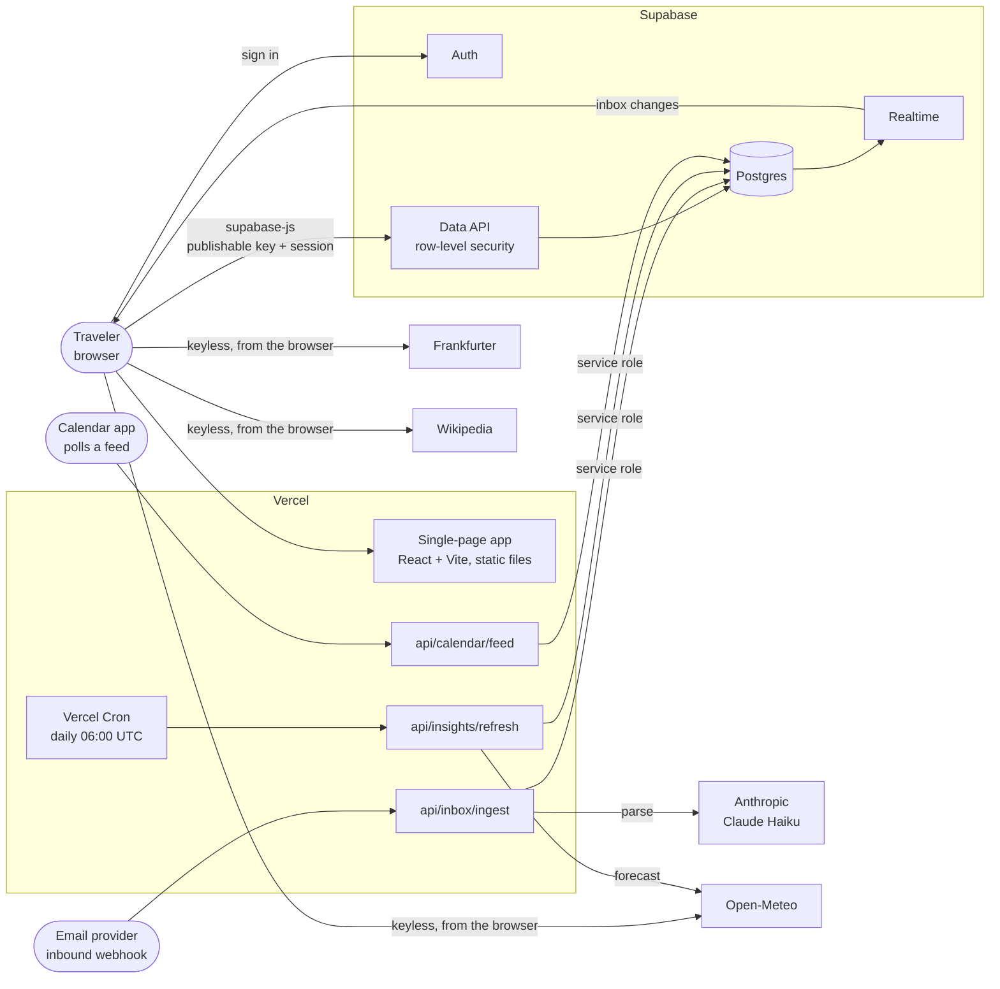
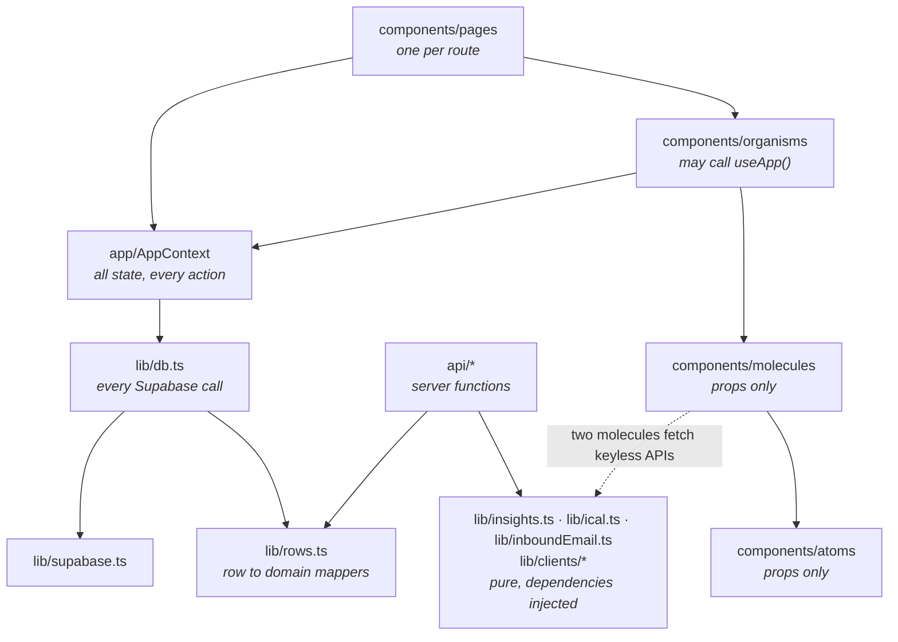
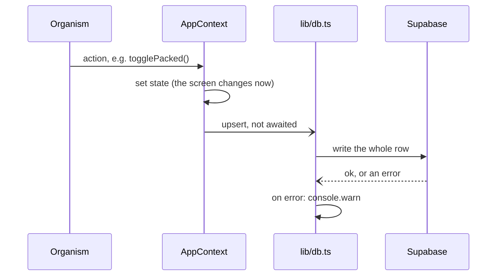
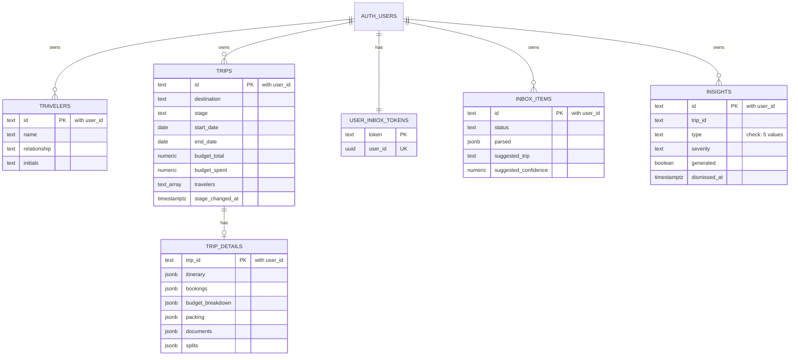
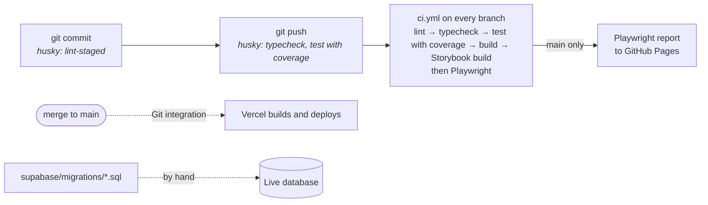

# Architecture: as built

What Travel OS is made of today, where each part runs, and why. This page describes `main` and production as they are. It changes in the same pull request as the code it describes (docs parity).

- **Where the app is going:** [`architecture/52-execution-grade-trips.md`](architecture/52-execution-grade-trips.md).
- **Why each choice was made:** [`decisions/`](decisions/README.md).
- **The standard this is measured against:** the [Engineering Handbook](https://github.com/qiheme/handbook), [Web app](https://github.com/qiheme/handbook/blob/master/blueprints/web-app.md) blueprint.

**Checked on 27 Nov 2026** against `main` at `e9e9c23`, the Vercel deployment record and the Supabase project. The handbook comparison uses its default branch as of the same day, after the Storybook and JSDoc rules (D26, D27) were added. Anything that could not be checked is listed under [Not verified](#not-verified).

## The system in one picture

## Where each part runs

| Part | Runs on | Talks to the database as | Source |
| --- | --- | --- | --- |
| The app | The browser, served as static files | The signed-in user, through row-level security | `apps/web/src/` |
| Sign-in | Supabase Auth: magic link, password, Google, Apple | — | `lib/db.ts` |
| Inbox ingest | A Vercel Function | The service role | `api/inbox/ingest.ts` |
| Insights refresh | A Vercel Function, started by Vercel Cron | The service role | `api/insights/refresh.ts` |
| Calendar feed | A Vercel Function | The service role | `api/calendar/feed.ts` |
| Schema | SQL files, applied by hand | — | `supabase/migrations/` |

This is the handbook's **browser-direct** pattern: the browser reads and writes its own rows, and database policies decide what it may see. See [decision 0001](decisions/0001-blueprint-web-app-browser-direct.md).

## Code layout and layers

| Rule | Enforced by |
| --- | --- |
| A component level imports from its own level or below, never above | `components/layers.test.ts` |
| Anything Cobalt provides is imported, not rebuilt | `components/cobalt-usage.test.ts` |
| Only organisms and pages call `useApp()` | Convention in `CLAUDE.md` |
| Pure logic takes its clock and its `fetch` as arguments | Convention; every `lib/clients/*` and `api/*` handler does |
| The server functions import pure modules from `apps/web/src/lib/` by relative path | Convention |
| Every component has a story file beside it, one story per variant and state, and Storybook builds in CI (D26) | `components/stories.test.ts`, and the `build-storybook` step in CI (#128) |
| Every export under `apps/web/src` has a JSDoc comment (what it does and why, no types), with no lint warnings allowed. The kit's `@param` and `@returns` rules are off: for a component with destructured props they only repeat the type | `eslint-plugin-jsdoc` in `eslint.config.js` (D27, #129) |
| Code outside the MVP is behind a build-time flag from `lib/flags.ts` (`VITE_FLAG_<NAME>`, off unless `true`), and only that module reads `VITE_FLAG_*` | `lib/flags.test.ts` |

Flags are fixed at build time, so turning one on is a rebuild and a redeploy, not a runtime switch. Each flag is its own exported constant with the comparison written inline. When `lib/flags.ts` was written, a throwaway probe string was put behind a flag and the bundle searched: with the flag off, the string was gone only for that shape, and stayed in the bundle when the flags were gathered into an object, compared inline inside an object, or read through a shared helper. The probe was not a real screen. **Nothing reads the two flags yet:** both are owned by issues outside the first release (#142, #143) and #137 will wire them in, so until then the Tweaks panel and the Google button are on screen whatever the flags say.

## State and the write path

All state is in one React context, `AppContext`. It holds server data (trips, trip details, insights, inbox) and interface state (theme, density, search, open panels) together.

Three properties of this path matter for what comes next:

| Property | Where | Consequence |
| --- | --- | --- |
| The screen changes before the server answers, and the answer is not read | `AppContext.tsx`: every action calls `void upsert…` | A failed write looks saved until the next reload |
| A read that fails returns an empty list | `lib/db.ts`: `if (error \|\| !data) return []` | "Could not load" and "nothing there" look the same |
| A trip's details are one row of JSON documents, written whole | `upsertTripDetail` sends itinerary, bookings, budget, packing, documents and splits together | Two devices on the same account can overwrite each other's changes to different tabs |

`AppContext.tsx` is excluded from the coverage requirement, so the write path is the least-tested logic in the app.

## Data model

| Fact | Detail |
| --- | --- |
| Keys | Every table is keyed on `(id, user_id)`. Ids are text, because the first rows come from shared fixtures |
| Row-level security | On for all six tables. One policy each: the owner may do everything, `to authenticated`, keyed on `auth.uid()` |
| Realtime | `inbox_items` is in the Realtime publication, so a parsed email appears without a reload |
| JSON documents | `trip_details` holds six. A booking, a packing item and a document have **no id**: the app addresses them by position in the array |
| `trips.travelers` | An array of traveler ids with no foreign key |
| First sign-in | The app seeds the fixture trips into a new account (`seedFromFixtures`): travelers and trips first, then details, insights and inbox, with every failed write logged. If the trips fail, nothing else is written and the next sign-in tries again; a failure after the trips are in leaves the account part seeded, because the check goes by the trips (#153). #136 may remove seeding altogether |
| Types | `lib/types.ts` is hand-written. Rows are cast to those types, not validated |

## Server functions

| Function | Started by | Caller proves itself with | Reads | Writes | Outside call |
| --- | --- | --- | --- | --- | --- |
| `inbox/ingest` | An email provider's webhook (Postmark, SendGrid or Cloudflare shapes), or a direct post | A shared secret | The user's active trips; the inbox token | `inbox_items` | Claude Haiku, to parse the email |
| `insights/refresh` | Vercel Cron daily, or by hand | A secret from the scheduler, or the shared secret | Trips and trip details for every user | `insights`: upsert generated rows, prune stale ones | Open-Meteo: geocode and forecast |
| `calendar/feed` | A calendar app, on its own schedule | The user's token in the address | Trips and trip details for one user | Nothing | None |

All three are written as a factory that takes its Supabase client, clock and `fetch`, with the production wiring exported beside it. That is why they are fully tested without a network, and why they can move to another runtime without a rewrite.

The model's reply is parsed as JSON and cast to a type. It is not validated against a schema. That is tracked in #41 on the parser hardening list (#39).

## Outside services and what they cost

| Service | Used for | Called from | Key | Cost today | What would make it cost money |
| --- | --- | --- | --- | --- | --- |
| Supabase | Database, sign-in, Realtime | Browser and functions | Publishable key in the bundle; service-role key on the server | Free plan | Leaving the free plan's limits; a second project; file storage (not used, by decision) |
| Vercel | Static hosting, three functions, one daily job | — | — | Free plan | Being replaced: see the target |
| Anthropic | Parsing one forwarded email per call | `inbox/ingest` | Server only | Per email parsed | Volume. Latency, tokens and cost per parse are not measured yet (#44) |
| Open-Meteo | Weather insights, destination geocoding | Browser and `insights/refresh` | None | Free | **Its free tier is for non-commercial use.** A product that charges, or carries ads, needs their paid plan. Check the terms before launch |
| Frankfurter | Exchange rates (European Central Bank reference rates) | Browser | None | Free | Nothing known |
| Wikipedia | Destination summaries | Browser | None | Free | Nothing. The text is CC BY-SA: the attribution link on each blurb is a licence condition |
| GitHub Actions and Pages | CI; the Playwright report | — | — | Free for a public repository | The repository going private |
| An inbound-email provider | Receiving forwarded confirmations | Calls `inbox/ingest` | — | Not set up, as far as the repository shows | Depends on the provider chosen |

## Build, checks and delivery

| Gate | Runs | What it checks |
| --- | --- | --- |
| pre-commit hook | Locally | `lint-staged`: ESLint with `--fix` on the staged files under `apps/web/src` |
| pre-push hook | Locally | `npm run typecheck && npm run test:coverage` |
| CI `check` | Every push and pull request, on the Node in `.nvmrc` | Lint, typecheck, unit tests with 100% coverage on all four measures, build, Storybook build |
| CI `playwright` | After `check` | Integration specs and nine visual snapshots, Chromium, 1280 × 800, against the dev server with a dev-only sign-in bypass |
| Deploy | Outside the repository | Vercel's own build. CI does not gate it |
| Migrations | Nowhere | No job applies or tests them |

Coverage is measured over `app/`, `components/`, `lib/` and `api/`. Five files are excluded: `lib/types.ts`, `lib/data.ts`, `lib/utils.ts`, `lib/supabase.ts` and `app/AppContext.tsx`.

| Tool | Version here | Handbook baseline |
| --- | --- | --- |
| Node | 24 | 24 |
| React | 18 | 19 |
| Vite | 8 | 8 |
| Vitest | 5 | 5 |
| ESLint | 10, flat config | 10 |
| React Router | 6 | Stays; TanStack Router is for new apps |
| Cobalt | 0.3 | 0.3 (0.4 is published) |

## Production today

| Fact | Evidence |
| --- | --- |
| The live build is from **25 Apr 2026**, commit `c4148a6` | Vercel deployment record |
| Four merges on `main` have not been deployed: Node 24 (#28), the `CLAUDE.md` expansion (#30), the keyless integrations with the migration files, calendar feed and daily insights job (#32), and the Cobalt and sign-in work (#47) | `git log` against that commit |
| The deployment record names the repository under its previous owner | Vercel deployment record. That this is why deploys stopped is an inference |
| There is no custom domain, and deployment protection covers every address the project has | Vercel project record. An email provider or a calendar app could not reach the functions as it stands |
| No Edge Functions exist in the Supabase project | Supabase project record |
| The database reported itself as hibernated and did not answer schema queries | Supabase, 27 Nov 2026 |

In short: the app on `main` has not been in front of a user since April. That removes one constraint from the target: there is no live traffic, subscribed calendar or webhook to keep working during a move.

## Gaps against the handbook

Stack-level gaps only. Each has an issue.

| Standard | Here | Issue |
| --- | --- | --- |
| Netlify, built on GitHub Actions; previews per pull request; release from a tag | Vercel's Git build; no preview or release workflow in the repository | #60, #123, #124 |
| Server code in Supabase Edge Functions; scheduled jobs on Supabase Cron | Vercel Functions and Vercel Cron | #120, #121, #122 |
| Migrations tested in CI and applied on release | Applied by hand | #115, #116 |
| zod at every boundary | Not a dependency; rows and model output are cast | #117, #41 |
| Model calls behind a provider adapter with a mock; model name from configuration | The SDK is called directly and the model name is in the handler | #121 |
| Failures returned as data | The data layer logs and returns nothing | #118 |
| Security headers and a Content-Security-Policy | None in the repository | #123 |
| End-to-end tests against the built output | Against the dev server | #119, #106 |
| `docs/architecture.md` | This page | #114 |

## Not verified

| What | Why not | What would settle it |
| --- | --- | --- |
| Which migration files the live database has run, and whether its schema matches them | The project did not answer on 27 Nov 2026 | #115 |
| Why Vercel stopped deploying | Read from one field of the deployment record | The Vercel project's Git settings |
| Whether any email provider is pointed at an ingest address | Not recorded in the repository | The owner |
| GitHub Actions secrets, variables and environments | Not readable from the session that wrote this page | Repository settings |
| How a hibernating Supabase project treats a scheduled job or an inbound call | Not looked up | #122 |
