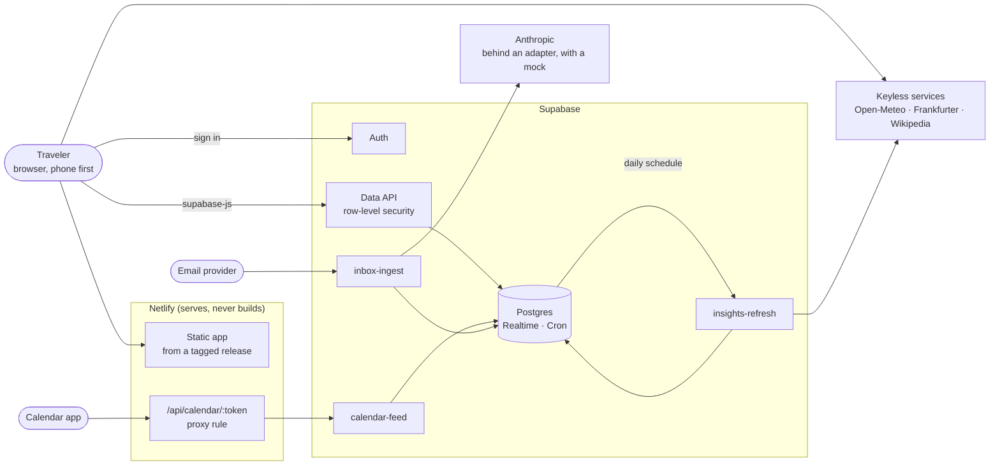
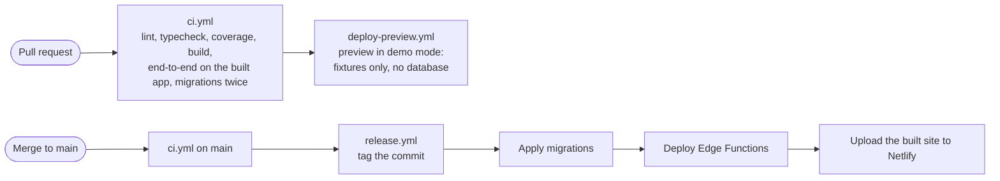
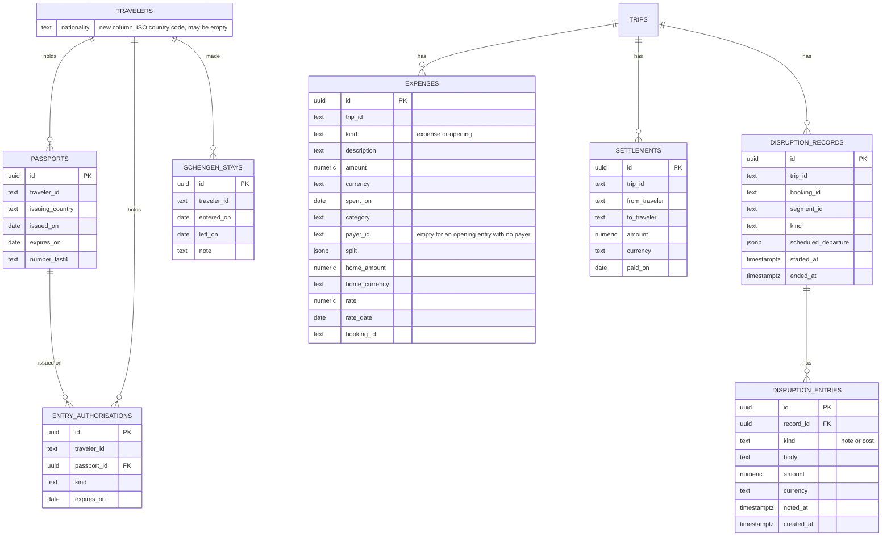
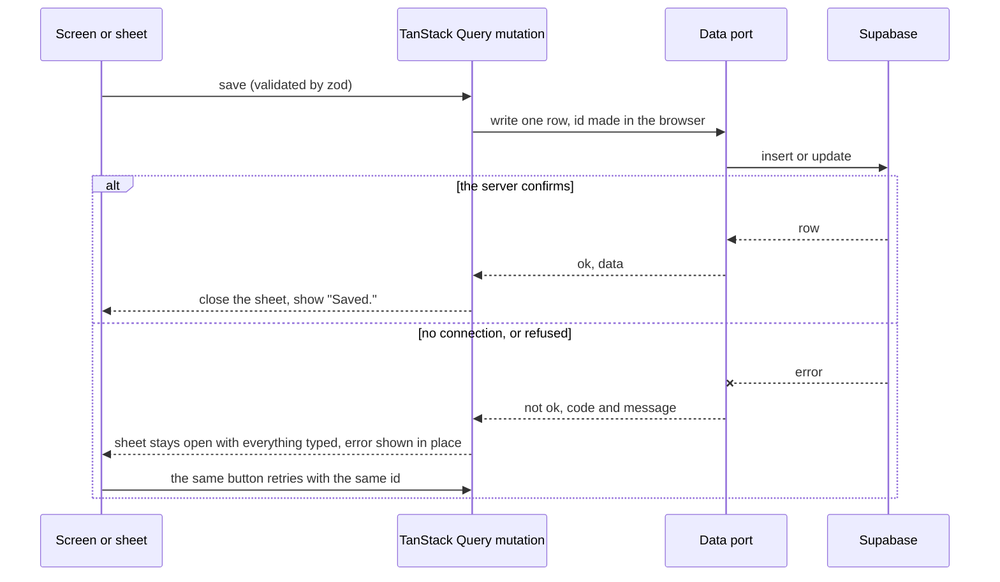

# Target architecture: execution-grade trips (#52)

What changes underneath the app to build #52, why, and in what order. The starting point is [`../architecture.md`](../architecture.md). Each choice here has a short record in [`../decisions/`](../decisions/README.md).

**Status: proposed.** Nothing here is built. It becomes the plan when the owner accepts the decision records.

## The plan on one page

| # | Change | Why | Where the work is |
| --- | --- | --- | --- |
| 1 | The blueprint does not change: a browser app on Supabase with row-level security | Every rule in #52 is "the owner sees their own rows" | [0001](../decisions/0001-blueprint-web-app-browser-direct.md) |
| 2 | Server code moves to Supabase Edge Functions; the daily job to Supabase Cron | The handbook standard, and #52 rewrites all three functions anyway | #120, #121, #122 · [0002](../decisions/0002-server-code-on-supabase-edge-functions.md) |
| 3 | Hosting moves to Netlify, built and gated by GitHub Actions. Previews run on fixtures | One pipeline; tests gate every deploy; a preview never touches real data | #60, #119, #123, #124 · [0003](../decisions/0003-netlify-hosting-and-demo-mode-previews.md) |
| 4 | New data goes in tables, one row per thing. One user action is one row write | A ledger and an evidence record must never be overwritten by an edit somewhere else | #76, #86, #93, #101 · [0004](../decisions/0004-tables-for-new-data-one-action-one-row.md) |
| 5 | Every read and write returns a result, through one data port, with TanStack Query holding server data | "Saved" may only show after the server says so | #118, #73 · [0005](../decisions/0005-write-results-and-server-data-layer.md) |
| 6 | zod at every boundary, shared by the browser and the functions | Three workstreams compute from stored JSON | #117, #41 · [0006](../decisions/0006-zod-at-every-boundary.md) |
| 7 | Rules and airports are data in the code, each with a source and a checked date | No rule is ever generated, and "unknown" is never shown as OK | #74, #87, #99 · [0007](../decisions/0007-reference-data-in-code.md) |
| 8 | A flight time is stored as the local time on the ticket plus its zone | A departure time is a fact about an airport, not about the server | #71, #76, #85 · [0008](../decisions/0008-flight-times-as-wall-time-plus-zone.md) |
| 9 | Money is `numeric` in the database, whole minor units in the maths, with the rate and its date kept on each expense | Balances must be checkable by hand and never drift | #93, #94, #96 · [0009](../decisions/0009-money-and-exchange-rates.md) |
| 10 | No offline queue, no file storage and no service worker in this release | Cost and scope, by the owner's decision | #108, #112 · [0010](../decisions/0010-no-offline-no-storage-in-this-release.md) |

## Target picture

The three boxes with function names are Supabase Edge Functions.

## What changes, layer by layer

| Layer | Today | Target | Story |
| --- | --- | --- | --- |
| Host | Vercel, building from Git | Netlify, uploaded prebuilt from a tagged release | #60, #124 |
| Previews | Vercel's, against the live database | A per-PR Netlify preview in demo mode | #60, #119 |
| Server functions | Three Vercel Functions under `api/` | Three Edge Functions under `supabase/functions/`, logic in `_shared/` | #120, #121, #122 |
| Daily job | `vercel.json` cron | Supabase Cron, created by a migration | #122 |
| Calendar address | `/api/calendar/<token>`, served by the host's function | The same address on the site's own domain, proxied to the Edge Function | #120, #123 |
| Migrations | By hand | Tested twice in CI; applied by the release before the deploy | #115, #116 |
| Data access | `lib/db.ts` calls Supabase and swallows errors | A data port with a Supabase adapter and an in-memory adapter; every call returns a result | #118 |
| Server data in the UI | `AppContext` state, changed before the server answers | TanStack Query; a mutation shows "saved" only on success | #118, #73 |
| Interface state | `AppContext` | `AppContext` (unchanged) | — |
| Validation | Type casts | zod schemas in a shared folder | #117, #41 |
| Shared pure code | `api/` imports `apps/web/src/lib/` by relative path | One folder of pure modules both runtimes import. The first function settles how | #120 |
| Model call | The SDK, called in the handler | A provider adapter with a mock; model name from configuration | #121 |
| End-to-end tests | Dev server, dev-only sign-in bypass, desktop only | The built app in demo mode; a phone project added | #119, #106 |
| Headers | None | `_headers` with a Content-Security-Policy for this app | #123 |

## Data

### What goes where

The rule ([0004](../decisions/0004-tables-for-new-data-one-action-one-row.md)): **one user action is one write to one row.** The browser cannot run a transaction across tables, and the network-down pattern (#73) needs every action to either happen or not.

| Data | Today | Target | Story |
| --- | --- | --- | --- |
| Traveler nationality | — | A column on `travelers` | #86 |
| Passports | An untyped entry in a trip's `documents` | `passports`: one row per passport, owned by a traveler | #86 |
| Entry authorisations (UK ETA and the like) | — | `entry_authorisations`: one row each, pointing at the passport it was issued on | #86 |
| Schengen stays the app does not know about | — | `schengen_stays`: one row per stay. Stays that are trips are computed, not stored | #86, #90 |
| Bookings, flight segments, who is on a booking | `trip_details.bookings`, no ids | The same JSON document. Every booking and segment gains a stable `id`; a booking gains `travelers`; a flight gains `segments`. Writes send the `bookings` column only | #76 |
| Expenses | A paid total and a share total per traveler in `trip_details.splits` | `expenses`: one row per expense, with its split inside the row | #93 |
| Settle-up payments | — | `settlements`: one row per recorded payment | #97 |
| "Spent" | `trips.budget_spent` and `budget_breakdown[].spent`, typed by hand | Computed from `expenses`. The old columns stop being written and stay in place | #98 |
| Disruption record | — | `disruption_records`: one row per record | #101 |
| Notes and costs in a record | — | `disruption_entries`: one row per entry, add-only | #101 |
| Insight types | A check constraint with five values | The constraint widened to ten | #91 |
| Entry rules, rights regimes, airports | One constant | Data files in the code, not the database | #74, #87, #99 |

### New tables

Column lists are the shape, not the migration. Each story writes its own migration, test first.

### Rules every new table follows

| Rule | Why |
| --- | --- |
| `user_id uuid not null`, row-level security on, one owner policy `to authenticated` keyed on `auth.uid()` | The handbook's rule for browser-direct tables, and what the six existing tables do |
| A foreign key to `trips (id, user_id)` or `travelers (id, user_id)` with `on delete cascade`, and an index on it | Deleting a trip removes its ledger and records. Unindexed foreign keys make that slow |
| The id is a `uuid` **made in the browser** and sent with the insert | A retry after a lost reply cannot create a second row: the second insert hits the same key and is treated as done |
| `numeric` for money, `date` for calendar days, `timestamptz` for moments that happened | Handbook Data rules |
| A `check` for every closed list (`kind`, currency length), written `col is not null and …` | A check passes on null |
| `disruption_entries` has policies for select and insert only | It is evidence. A correction is a new entry. #101 confirms this against screen 15 before the migration is written |
| Only add. A column that stops being used is dropped in a later pull request | Migrations run before the new code is live, and a rollback never reverts the schema |
| The passport number is never stored. Only the last four characters are kept, and only if typed | Nothing in the app needs the number |

### Changes to existing data

| Change | How | Story |
| --- | --- | --- |
| Give every stored booking an `id` | A migration adds one to each booking that lacks it. Ids are made once, in the database, so two devices never invent different ones. Running it twice changes nothing | #76 |
| Turn `splits` and typed "spent" totals into opening entries | A migration inserts `expenses` rows with ids derived from the trip and traveler, so a second run inserts nothing. A test compares every balance before and after | #93 |
| Widen `insights.type` | Drop and re-create the check with the five old values and the five new ones, in one migration | #91 |
| Calendar event ids | Derived from the booking `id`, not from the confirmation code. Safe to change now: the feed has never been deployed, so no calendar is subscribed | #85 |

## The write path

| Rule | Why |
| --- | --- |
| Nothing is shown as saved, filed, paid or deleted before the server confirms | The promise in #73 |
| The data port is the only code that imports the Supabase client | One place to return results, and one seam for the in-memory adapter |
| A read that fails is an error state, not an empty list | "Could not load" must not read as "nothing here" |
| Logic moved out of `AppContext` is tested. The coverage exclusion list does not grow | The write path is where the risk is |
| Existing trip data moves to the new layer when a story next touches it, not in one sweep | Keeps each pull request reviewable |

## Server functions

| Function | Trigger | Caller proves itself with | JWT check | Change in #52 |
| --- | --- | --- | --- | --- |
| `calendar-feed` | A calendar app, through the site's `/api/calendar/<token>` proxy | The user's feed token | Off, set in `config.toml`; the handler checks the token | Timed events for flight segments (#85) |
| `inbox-ingest` | The email provider's webhook | The webhook's own credential, checked first | Off, set in `config.toml` | Reads flight segments; schema-checked output (#83, #41) |
| `insights-refresh` | Supabase Cron, daily | A secret header | Off, set in `config.toml` | Five readiness insight types (#91) |

Every function follows the handbook's Functions blueprint: `index.ts` reads configuration, builds the real ports and calls the handler; the handler authenticates, validates, loads, acts and persists; errors are sanitised; writes are idempotent. Secrets live in Supabase Function secrets and nowhere else.

Nothing new runs on the server for workstreams 3 and 4. The ledger maths, the rights logic, the disruption timer and the claim letter are pure functions in the browser. The claim letter is built as text and offered through the clipboard, a file download and the print dialog: no server, no storage and no new dependency.

## Environments

| Environment | Code | Data | Who can reach it |
| --- | --- | --- | --- |
| Local | `npm run dev` | Demo mode by default; the real project with a local `.env` | The developer |
| Preview | The pull request's build, uploaded by the trusted workflow | Fixtures in memory. No Supabase client exists in the build | Anyone with the link |
| Production | A tagged release | The one Supabase project | Signed-in users |

There is no staging database. A preview cannot need a table that has not been migrated, because it never talks to a database.

## Reference data

| Data | Lives in | Each entry carries | Guard |
| --- | --- | --- | --- |
| Entry rules | A typed table in the shared pure code | The rule, its official source, the date it was last checked | A test fails if an entry has no source or no date. #92 checks each line against its source |
| Passenger-rights regimes | The same | The regime, the dates it applies from and to, its source | The same, and #103 |
| Airports | A static file, loaded only when an airport field or a rights or readiness check needs it | Code, name, city, country, zone, coordinates, EU and Schengen flags | The source, its licence and the measured size are written in the README (#74) |

Both functions and the browser read the same files, which is one more reason the pure code is shared.

## Story map

Architecture that belongs to one experience is written into that story. This table is the index.

| Story | What it changes underneath | Needs first |
| --- | --- | --- |
| #73 Network-down pattern | The shared error and offline components sit on the mutation result | #118 |
| #74 Airport list | Static file, lazy-loaded, in the shared pure code | — |
| #76 Segments and travelers on a booking | Ids on bookings and segments; schema; column-scoped write; wall time plus zone | #116, #117, #118 |
| #83 Parser reads segments | Runs in the `inbox-ingest` Edge Function behind the provider adapter | #121, #41 |
| #85 Timed calendar events | Runs in the `calendar-feed` Edge Function; event ids from booking ids | #120, #76 |
| #86 Nationality, passports, authorisations, stays | One column, three tables | #116, #117 |
| #87 Rules table and readiness engine | Pure module in the shared code; reference-data test | #86, #76 |
| #91 Readiness insights | Constraint migration; runs in `insights-refresh` | #122, #116, #87 |
| #93 Expenses and settlements | Two tables; opening-entry migration | #116, #117, #118 |
| #94 Ledger maths | Pure module; whole minor units | — |
| #96 Expense editor | Dated exchange rate, stored on the row | #93 |
| #98 One "spent" figure | Old columns stop being written | #94 |
| #99 Rights logic | Pure module; date-aware reference data | #76, #74 |
| #101 Disruption mode | Two tables; add-only entries; ids made in the browser | #116, #118, #99 |
| #102 Claim letter | Browser only | #101 |
| #106 End-to-end journeys | The built app in demo mode; a phone project | #119 |

## Order

| Wave | Stories | Must land before |
| --- | --- | --- |
| 0. Write it down | #114 | Everything |
| 1. Tidy | #126, #53, #55 to #59, #61 to #63, #125 | Nothing depends on it, but it is cheapest first |
| 2. Make data safe | #115 → #116; #117 → #118 → #119 | Any story in #52 that writes a migration or a form |
| 3. Move the server code | #120 → #121, #122 | #83, #85, #91 |
| 4. Move the host | #60 + #123 → #124 | The first release of #52 to production |

Workstream 3 (the ledger) needs only waves 0 to 2. It can start while waves 3 and 4 are in progress.

**Size of the standalone work** (#114 to #126): one XS, five S, seven M on the issue-form scale. These are estimates, not dates.

## Running cost

| Change | Effect on cost |
| --- | --- |
| Leaving Vercel for Netlify | Free plan to free plan |
| Edge Functions and Supabase Cron | Inside the Supabase free plan at this volume. Not verified against the current plan limits |
| Demo-mode previews | Avoids a second Supabase project |
| No file storage, no offline queue | Avoids Supabase Storage (#112) |
| Airport list | A static file. No service, no key |
| Dated exchange rates | Frankfurter, keyless. One call per expense in another currency |
| Open-Meteo | Unchanged, and still the one to check: its free tier is for non-commercial use |
| Error monitoring | Not added. A new vendor needs its own issue (handbook open decision O6) |

## Risks and what is not verified

| Risk or gap | Effect | Settled by |
| --- | --- | --- |
| How Deno imports pure modules that the Vite app also imports (file extensions, files outside `supabase/functions/`) | Decides where the shared code lives | #120, the first function |
| How Edge Functions are deployed from the release workflow | The handbook lists it as open (O3) | #120 |
| What a hibernating free-tier project does with a scheduled job and an inbound call | If it sleeps through them, the daily job and the calendar feed are unreliable on the free plan | #122 |
| Netlify proxying `/api/calendar/<token>` to a Supabase function address, with private caching intact | If it cannot, the feed is a Netlify Function instead (the handbook's stated exception) | #120, #123 |
| Frankfurter's dated-rate endpoint and how far back it goes | Decides the "rate unavailable" state in #96 | #96 |
| The live schema | Unknown until read | #115 |
| Two devices on one account editing the same trip's bookings | Reduced, not removed: a write now sends one column, not six. [0004](../decisions/0004-tables-for-new-data-one-action-one-row.md) says what would move bookings to a table | Watch |
| The standalone work is large next to the features it supports | Seven M-sized stories before or beside the first feature | The owner's call on order; wave 2 is the only hard gate |
